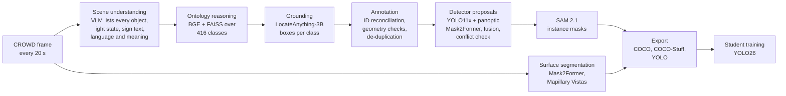

# TraffCOCO

**A worldwide, multilingual traffic-scene dataset built from dashcam video in 238 countries.**

TraffCOCO labels everything on and beside the road in frames from the
[CROWD](https://github.com/crowd-dataset/crowd) dashcam dataset:
- **Road users and vehicles:** cars, buses, auto rickshaws, cyclists, pedestrians and others.
- **The road surface and its structure:** road, sidewalk, curb, bike lane, crossings, lane markings and terrain.
- **Traffic control:** each traffic light's state, and each sign's text with its language and English meaning, in any script.

Every annotation is COCO-compatible.

CROWD has 84,038 videos from 10,735 localities in 238 countries. Sampling one frame every 20 seconds gives roughly 15 to 18 million frames.

**The plan has two parts:**
1. Label 2 to 3 million of these frames with a slow, high-quality *teacher* pipeline built from open foundation models.
2. Check that teacher against human labels, distil it into a fast *student* model, and use the student to annotate the full set.

> All figures are clickable: each one opens an interactive version (zoom, hover for labels).

[](https://htmlpreview.github.io/?https://github.com/crowd-dataset/TraffCOCO/blob/main/figures/examples.html)

*Left: original CROWD frames from Japan, India and the Netherlands, by day and at night. Right: the teacher pipeline's output.*
- **Boxes and instance masks** are the objects.
- **Tinted regions** are the road surface classes.
- **Sign labels** show the sign's meaning. The Toyokawa sign 次の信号 左折 is exported with `text`, `language: Japanese` and `meaning: next signal: turn left`.

These are raw pilot outputs, not curated results; their known errors are listed under [Current status](#current-status).

## Why TraffCOCO

Existing driving datasets do one of two things:
- they cover one or a few countries in detail (Cityscapes, KITTI, BDD100K, nuScenes);
- they cover many countries with a fixed label set and no sign text (Mapillary Vistas).

Three things are missing at scale:

1. **Geographic and cultural breadth.**
   - Road layouts, vehicles (auto rickshaws, jeepneys, kei trucks), markings and signs differ strongly between regions.
   - CROWD covers 238 countries, day and night, in naturalistic driving by many different drivers and cameras.
2. **Fine-grained traffic semantics.**
   - Downstream questions need more than "car / person / sign": what a sign says, what state a light is in, whether there is a bike lane or a sidewalk.
   - TraffCOCO uses a 416-class traffic ontology with country-specific sign classes, plus per-pixel surface classes.
3. **Text in the scene, in any language.**
   - Guide and warning signs are often written, not drawn.
   - TraffCOCO keeps the text in its original script, names the language, and gives an English meaning, so a sign keeps what it says in any language. So far this has been tested on Japanese.

## Research plan

| Phase | What | Output |
|---|---|---|
| 1. Teacher labelling | Run the pipeline below on 2–3 M frames, stratified by continent, country, day/night and vehicle type. | Objects, instance masks, surface masks, light states, sign text |
| 2. Quality assurance | Hand-label a gold set stratified the same way, measure the teacher's per-class precision and recall, calibrate its scores, and filter by agreement between models. | Measured label quality per class and per region |
| 3. Student distillation | Train detectors and segmenters (YOLO26 n to x, `training/`) on the teacher labels. Use active learning to send the student's least certain and most novel frames back for teacher or human relabelling. | Fast models that label a frame in milliseconds |
| 4. Full-scale annotation | Label the remaining ~15 M frames with the best student, with the same quality checks on a held-out sample. | TraffCOCO, ~17 M frames |
| 5. Benchmarks and release | Define tasks and baselines (below), release labels, code and models. | Dataset, leaderboard splits, baselines |

**Planned benchmark tasks:**
- **Object detection and instance segmentation** over the long-tailed ontology.
- **Surface segmentation** of road, sidewalk, curb, bike lane, crossings and markings.
- **Traffic-light state** recognition.
- **Sign reading:** OCR plus meaning, scored per script and language.
- **Cross-region generalisation:** train on some continents and test on others, to measure the geographic bias of current models.

**Leakage control:** train, validation and test splits are assigned per *video*, by hashing the video ID (80 / 10 / 10). Frames from one drive, which look nearly the same, never end up on both sides of a split.

## Pipeline

The teacher is a chain of open models, run per frame from `main.py`:



| Stage | Model | What it does |
|---|---|---|
| Frame sampling | – | Downloads CROWD videos and takes frames every `interval_seconds` (20), filtered by place, time of day, vehicle and video ID. |
| Scene understanding | Gemma 3 12B (default), Gemma 4, Qwen3-VL-8B or SmolVLM2 | Lists every traffic-relevant object with a description, light state and, for signs, the exact text in its original script, its language and English meaning. The prompt is chosen in the config. An answer that repeats itself or is cut off by the token limit loses its repeats and gets one short follow-up question for the vehicles and road users in the frame. |
| Ontology reasoning | `BAAI/bge-base-en-v1.5` + FAISS | Maps each object to one of 416 ontology classes and the prompt used for grounding (`annotation_pipeline/models/ontology/traffic_ontology_v2.json`). A sign whose words the chosen class cannot represent becomes `guide_information_sign`, and the replaced class is kept for review. |
| Grounding | `nvidia/LocateAnything-3B` | Finds boxes for each class prompt. Names with leaked coordinate tokens (`traffic<799>`) are dropped, and fused names (`carUV` from "car" and "SUV") are matched back to the prompt name they start with. |
| Annotation | – | Links boxes to scene objects and removes slivers (under 6 px or 64 px²), implausible sizes and duplicates of the same object, keeping distant small objects such as traffic lights. Lane lines and hatched areas are taken from the surface masks instead of boxes; compact painted symbols (arrows, crossings, stop lines) stay objects. |
| Detector proposals | YOLO11x (COCO) and `facebook/mask2former-swin-large-mapillary-vistas-panoptic` | Boxes from two street-scene detectors: YOLO11x for cars, people, vehicle traffic lights and motorcycles; the Vistas panoptic model (run at up to 1920 px, not its 384 px default) for traffic signs, trucks, buses, billboards, riders, crosswalks and manholes. Each grounding box of these groups that a detector box matches (IoU 0.5) keeps its finer label and takes the detector's box; detector boxes no grounding box matched are added with a general class, and grounding boxes of these groups that no detector confirms are dropped. Person boxes lying inside a billboard (printed people) are dropped. Proposals are cached in `outputs/detector_proposals/`; `detector_proposals.enabled` in the config turns the stage off. |
| Conflict check | Scene VLM | When two labels claim one box (merged duplicates, or a box of another class nested in it), the VLM sees a crop with the box drawn in red and picks the label; the box is kept, relabelled or dropped as a duplicate. Every other vehicle and road-user box is asked its class among the common ones (car, SUV, van, pickup, truck, bus, motorcycle, bicycle, pedestrian; for people also cyclist and motorcyclist), "two or more separate objects" and "not a vehicle or person"; boxes of a description that was grounded to more than one box also get every vehicle and road-user label in the frame. Every cyclist or motorcyclist box is also asked its rider type, and a rider then takes the class of the motorcycle or bicycle under it. An answer that would change a box is asked again with the options reversed and used only if both agree (small VLMs favour options by position); vehicle and person boxes are always asked in both orders, a rare subtype such as "kei car" picked in one order only gives way to the common class picked in the other, and they are dropped only when both orders reject them. A relabel is also skipped when the chosen label belongs to a neighbour lying inside the box. Sign, road-marking, roadside and temporary-object boxes are verified one by one against their own label, the classes the ontology lists as confusable with it, "several objects" and "none of these"; sign boxes are also offered shop sign, billboard, the general traffic-sign class (`unreadable_traffic_sign`, named as any other or unreadable sign) and "not a sign" (dropped), on a crop at least 200 frame pixels across; streetlight boxes are also offered "a pole without a lamp" (dropped). Every vehicle traffic-light box is asked which lamp is lit (red, yellow, green, or none visible, which gives the stateless traffic-light class), since the scene model's state was shared by every box of a described light. About 1.2 s per question. A detector box keeps its detector group (the VLM may only pick a finer class of the same group, such as taxi for a car or a light's state), and it is not dropped on a "not seen" answer when the detector was at least 0.7 sure. |
| Instance masks | SAM 2.1 Hiera Large | One mask per final box. Cones, posts and bollards are checked against their mask: boxes wider than tall are dropped, and a "cone" that does not narrow becomes `flexible_post`. Of two boxes in the same ontology group whose masks share at least 60% of the smaller mask, the smaller is dropped as a duplicate or fragment. |
| Surface segmentation | `facebook/mask2former-swin-large-mapillary-vistas-semantic` | Per-pixel labels for 26 road and roadside classes: road, sidewalk, curb, bike lane, crossings, lane markings, terrain, vegetation, barriers, bridges and more. Also checks boxes: line markings come from these masks, and a guardrail or barrier whose SAM mask lies mostly on road, sidewalk or curb is dropped. |
| Road perception (optional) | YOLOPv2 | Drivable area and lane lines. |
| Export | – | COCO instances, COCO-Stuff surfaces and YOLO labels from one source of truth, split by video. |
| Student | YOLO26 | Training and inference in `training/`. |

### Output format

Per run, under `outputs/`:

```text
outputs/
├── COCO_FORMAT/
│   ├── images/{train,val,test}/
│   └── annotations/
│       ├── instances_{train,val,test,final}.json   objects + instance masks
│       └── surfaces_final.json                     road surface masks (COCO-Stuff style)
├── YOLO_FORMAT/                                     images, labels, data.yaml
├── FINAL/visualizations/<frame>_FINAL.png           combined view as in the figure
├── surface_segmentation/masks/<frame>_surface.png   uint8 label map + classes.json
├── scene_cache/{raw,parsed}/                        VLM answers per frame
├── pipeline_cache/                                  per-object scene, ontology and grounding record
└── dropped/                                         boxes removed by post-processing, for review
```

An object annotation carries the usual COCO fields plus its provenance. Signs with readable text also carry their text:

```json
{
  "category_id": 7,
  "bbox": [0, 70, 200, 114],
  "area": 22029,
  "segmentation": {"size": [720, 1280], "counts": [...]},
  "object_id": 2,
  "scene_confidence": 1.0,
  "ontology_score": 0.67,
  "sam_score": 0.98,
  "attributes": {"text": "次の信号 左折", "language": "Japanese", "meaning": "next signal: turn left"},
  "alternative_labels": ["parking_sign"]
}
```

## Current status

**Pilot stage.** The full chain runs end to end on an NVIDIA DGX Spark (GB10). On the six frames in the figure, a box-by-box check by eye found 60 of 69 decidable boxes correct (87%; 17 more boxes were too small or blurred to judge, 86 in all). An earlier run without the mask and VLM conflict checks scored 56 of 74 (76%).

| Frame | Boxes | Correct | Wrong | Undecidable |
|---|---|---|---|---|
| Tokyo, Japan | 11 | 7 | 1 | 3 |
| Toyokawa, Japan | 11 | 10 | 1 | 0 |
| Bengaluru, India | 26 | 18 | 2 | 6 |
| Amsterdam, Netherlands | 9 | 5 | 2 | 2 |
| Eindhoven, Netherlands | 25 | 16 | 3 | 6 |
| Tilburg, Netherlands | 4 | 4 | 0 | 0 |
| **Total** | **86** | **60** | **9** | **17** |

Vehicles, people, riders, flexible posts, streetlights, traffic lights and the Japanese guide sign were right. The nine errors are mostly signs and infrastructure: a sign box on foliage, a "zebra crossing" on a canal edge, a "construction ahead sign" on an excavator, a shop sign labelled `billboard`, boxes on empty sky or bare wall, a road-arrow box reaching down to the dashboard, a sliver beside a car, and one box over two parked vehicles. Some objects get no box at all (a cyclist on a median, a person standing behind a rider, a shipping container, bollards). This is a small pilot sample, not a benchmark.

**Global check, 100 random frames.** To see how the pipeline holds up outside these six frames, 100 frames were cut at random times from CROWD videos covering 38 countries (Europe 43, Asia 26, North America 14, Africa 9, Oceania 5, South America 3; 87 by day, 13 by night) and every box was checked by eye in the same way. Of 779 decidable boxes, 543 were correct (70%); 61 more could not be judged, and 179 clearly visible objects had no box. Two frames showed no traffic object the scene model could name.

| Object group | Correct | Wrong | Accuracy |
|---|---|---|---|
| Road users | 30 | 2 | 94% |
| Vehicles | 260 | 63 | 81% |
| Road infrastructure | 159 | 49 | 76% |
| Traffic lights | 19 | 18 | 51% |
| Traffic signs | 53 | 69 | 43% |
| Road markings | 6 | 15 | 29% |

Smaller groups (temporary objects, animals and labels outside the ontology) are left out of the table.

By continent: Asia 80%, Africa 73%, Europe 69%, South America 67%, North America 54%, Oceania 53%; night frames (75%) were no worse than day frames (69%). The largest causes were fixed afterwards and checked again on the worst frames of this run:

| Fix | Frames | Before | After |
|---|---|---|---|
| Scene model looped (28 of 98 frames) and never named the cars: follow-up question for vehicles and road users | 8 looping frames | 30 boxes correct, 42 objects missed | 72 correct, 13 missed |
| Shop boards, adverts and backs of signs labelled as traffic signs; garbled grounding names: sign choices in the conflict check, name filter | 10 frames with the most wrong sign boxes | 60% of boxes correct, 42 wrong sign boxes | 71%, 15 wrong sign boxes |
| One light state shared by every box of a light; second boxes and fragments of one object: lamp question per light box, mask duplicate check (with the fixes above) | 10 frames with the most wrong light and duplicate boxes | 53% of boxes correct; lights 6 right, 17 wrong; 15 duplicates | 84%; lights 15 right, 5 wrong; 3 duplicates |
| Wrong vehicle and person classes (ordinary cars as "kei car" or "van", laundry as pedestrians), boxes over several objects, poles as streetlights: class question for every vehicle and person box in both option orders, "several objects" and "pole without a lamp" answers (with the fixes above) | 10 frames with the most wrong-class and multi-object boxes | 56% of boxes correct; 12 wrong vehicle types; 12 wrong streetlight boxes; about 13 boxes over several objects | 76%; 5; 1; 5 |

**Human-labelled check, Mapillary Vistas.** On 200 Mapillary Vistas v2.0 validation images with human instance labels, the pipeline's boxes were compared with the labels by coarse group (car, person, rider, traffic light, traffic sign, shop sign or billboard, crosswalk, truck, bus, ...) at IoU 0.5; regions Vistas labels only as a group (rows of parked cars, sign backs) excuse a box at least half inside them, as COCO's crowd regions do. The first 40 images (sorted by name) were used for tuning and the other 160 held out.

| Pipeline (held-out 160 images) | Precision | Recall | F1 |
|---|---|---|---|
| VLM and grounding only | 75.2% | 23.9% | 0.363 |
| With detector proposals | 77.9% | 39.9% | 0.528 |
| With the conflict-check rule for detector boxes and the billboard filter | 77.1% | 44.1% | 0.561 |

Many labelled Vistas objects are tiny (a few pixels); for objects at least 24 px across the last row reaches 80.5% precision and 69.0% recall (all 200 images).

**High-precision export.** `tools/quality_gate.py` writes `instances_precise.json` next to the full export. It keeps only the boxes that pass a confidence cut-off for their group and source (a detector box that grounding also found, a detector box alone, or a grounding box alone) and a minimum size. The cut-offs (`tools/quality_gate_vistas.json`) were fitted on the 200 Vistas images and checked by 5-fold cross-validation over images:

| Objects | Precision | Recall |
|---|---|---|
| All sizes (default) | 90.9% | 32.8% |
| At least 16 px | 91.0% | 51.8% |
| At least 24 px | 90.1% | 59.1% |
| At least 32 px | 90.5% | 63.5% |

The gate drops rare classes found by grounding alone (arrows, pedestrian signals, cones, bicycles) and keeps only confident detector-only shop signs, traffic signs, crosswalks and manholes. With a minimum size it also drops streetlights, which Vistas labels as the lamp head only (under 24 px), so they cannot be measured there. In a by-eye look at 48 of the 174 boxes the gate keeps that Vistas counts as false (at least 24 px), about half were real objects Vistas does not label (route and street-name signs, parking signs, cars behind fences, posters), so the true precision is likely higher. The remaining errors include cyclists called pedestrians, LED speed signs called traffic lights and boxes over two objects. The Vistas panoptic model was trained on Vistas, so these numbers are optimistic for CROWD frames.

A veto then drops the boxes that a small gradient-boosted model (`tools/quality_gate_veto_vistas.json`, fitted with `tools/fit_quality_gate.py`) scores below 0.2 (`--veto 0` turns it off). The model reads only what the export keeps: group, source and detector, the detector, SAM, scene and ontology scores, the box size and place in the image, and how the box overlaps the others. Under cross-validation on a newer run of the 200 Vistas images, the veto raised precision by 0.3 to 0.7 points at every minimum size and lost no real objects. On the CROWD frames below it raised precision from 89.5% to 90.9%, mostly by dropping wrong posts and barriers and some shop signs. Used alone with its own cut-offs, the model gained 2 to 4 recall points at about 90% precision on Vistas, but on CROWD it kept only half as many real objects as the cut-offs. It drops classes Vistas does not label (bollards, guardrails) and was stricter on CROWD frames for every group, so it is used only as a veto.

Most of the recall still missing on Vistas is a detection limit, not a gate limit: 44% of the labelled Vistas objects are under 16 px (mostly distant street lamps, signs and lights) and the full export finds only 18% of those. Two ways to raise that ceiling were tested and not kept. On 80 of the images, running both detectors on 2x2 upscaled tiles found 7 points more objects, but its extra boxes were only about half right, so the gate kept 1 to 2 points more recall for four times the detector time. The panoptic model's street-light boxes were only 52-60% right on Vistas itself.

**CROWD check.** On the 100 global frames above, three runs were reviewed box by box with one rubric (by Claude from crops, not by people): the run before the detector stage, the first run with detector proposals and the current pipeline. Each box is scored for the right kind of object, exactly right including the fine class, and relative recall (the share of all real objects that any of the runs found). Unsure boxes are left out.

| 100 CROWD frames | Boxes | Right kind | Exactly right | Relative recall |
|---|---|---|---|---|
| Before the detector stage | 841 | 81.6% | 76.2% | 56.7% |
| With detector proposals, full export | 1180 | 84.9% | 79.2% | 82.5% |
| Current pipeline, full export | 1238 | 83.3% | 77.9% | 88.0% |
| Current pipeline, cut-offs only | 801 | 89.5% | 84.1% | 63.6% |
| Current pipeline, `instances_precise.json` (cut-offs and veto) | 755 | 90.9% | 85.2% | 60.8% |

The detector stage finds about half again as many real objects with fewer errors per box; shop signs and traffic signs gained most. CROWD frames are smaller than Vistas images, so a 24 px minimum kept far fewer real objects at the same precision (38% relative recall in the first check), which is why the gate keeps every size by default. Most remaining errors in `instances_precise.json` are streetlight boxes (32 of 103 wrong: part of the pole or a pole without a lamp), which Vistas cannot judge, then video logos and titles taken for signs or billboards, chevron posts taken for signs, riders called pedestrians and pedestrian signals called vehicle lights.

Known issues that phase 2 must measure and fix:

- **Scene-model reliability.** Qwen3-VL-8B loops in about a quarter of frames, repeating one object until its token limit. The repeats are dropped and a follow-up question recovers most vehicles and road users, but signs and markings it never reached stay missing. Gemma models are the default.
- **Grounding.** LocateAnything sometimes boxes the wrong thing (a pillar as a "flexible post", tail lights as traffic lights, a curb as a guardrail). The mask checks after SAM 2 and surface segmentation catch some of these. It returned no boxes for a low-resolution (640×360) frame in some runs. It also samples at temperature 0.7, so runs are not deterministic.
- **One description, several boxes.** A light's state, or a sign's text, is decided once per described object. When that object's query returns several boxes, the state is shared by all of them, and the sign text is attached to none (it is unknown which box says it).
- **Fine-grained confusions.** A real sign often gets the wrong sign class (a keep-right sign as `roundabout_sign`, a speed limit as `guide_information_sign`); the conflict check cannot yet find the right class, which needs the sign's meaning mapped back to the ontology. Small real signs (under about 45 px) with a wrong class are often answered "not a sign" and dropped, with Qwen3-VL-8B and 32B alike: 6 of 31 drops in the last test removed a real object (direction, parking and warning signs, street lamps on utility poles, a small car), and pedal bicycles are still called "motorcycle". Traffic-light states are now checked box by box, but the VLM still reads some small red lamps as green, and the duplicate check sometimes keeps the larger of two boxes when the smaller one was the right box or a separate, partly hidden object. Utility poles called `streetlight` are now mostly dropped as "a pole without a lamp", but so is the odd lamp mounted on a utility pole. Small or blurred night lights are hard to tell apart (headlight, streetlight or traffic light). Some boxes still span a row of parked cars or two neighbouring objects. Flexible posts called "traffic cone" by the scene model are now caught by a shape check on the SAM mask (a cone narrows towards the top, a post does not).
- **Throughput.** Measured on the DGX Spark: the VLM is the bottleneck (minutes per frame for large models), LocateAnything takes tens of seconds per frame, and SAM 2 and Mask2Former take under two seconds. Phase 1 needs batched VLM serving on HPC.

## Getting started

[](https://www.python.org/downloads/release/python-31213/)
[](https://docs.astral.sh/uv/)

Tested with **Python 3.12.13** and [`uv`](https://docs.astral.sh/uv/). A CUDA GPU is needed for the models. On aarch64 (e.g. DGX Spark) `flash-attn` and `decord` have no wheels: install with `uv sync --frozen --no-install-package flash-attn --no-install-package decord`. LocateAnything then falls back to SDPA attention.

1. Install `uv`:
   ```bash
   curl -LsSf https://astral.sh/uv/install.sh | sh
   ```
   On Windows (PowerShell): `irm https://astral.sh/uv/install.ps1 | iex`. If `uv` reports `Permission denied` under `~/.local/share/uv`, make sure you own that folder (`chown -R "$(id -un)" ~/.local/share/uv`).
2. Clone the repository and install the locked environment:
   ```bash
   git clone https://github.com/crowd-dataset/TraffCOCO
   cd TraffCOCO
   uv python install 3.12.13
   uv sync --frozen
   ```
3. Create your configuration and secrets from the defaults. Both files are required:
   ```bash
   cp default.config config
   cp default.secret secret
   ```
   `secret` holds the file-server credentials used to download CROWD videos (leave them empty for public access).
4. Run the pipeline on a few frames:
   ```bash
   uv run python main.py --images 5
   ```

### Command-line options

| Option | Meaning |
|---|---|
| `--images N` | Number of frames to process (0 = all in the input folder). |
| `--start-stage STAGE` | Resume from a stage using the cached results of the earlier ones: `scene_understanding`, `ontology_reasoning`, `grounding`, `yolopv2`, `annotation`, `semantic_verification`, `sam2`, `surface_segmentation`, `final_output`, `dataset_export`, `yolo_training`, `yolo_inference`. |
| `--no-sam-segmentation` | Skip SAM 2 instance masks. |
| `--no-yolopv2` | Skip YOLOPv2 road perception. |

### Configuration

`config` is a JSON file with the same keys as `default.config`; `main.py` stops with a list of any keys missing from it. The main groups:

- **Stages:** `run_scene_understanding`, `run_ontology_reasoning`, `run_grounding`, `run_annotation`, `run_segmentation` (SAM 2), `run_surface_segmentation`, `run_conflict_check`, `run_semantic_verification`, `run_yolo_training`, `run_yolo_inference`.
- **Models:** `scene_understanding_backend` (`gemma`, `gemma4`, `qwen`, `smolvlm`) with its model ID under `scene_understanding`, `scene_understanding_prompt` (a file in `annotation_pipeline/prompts/`), `ontology_reasoning.embedding`, `grounding.locate_anything_model_id`, `segmentation.sam2_model_id`, and `surface_segmentation` (`model_id`, `max_side`, and `classes`; an empty list keeps the 26 default classes).
- **Frame sampling:** `download_random_frames`, `num_images`, `interval_seconds` (20), `base_url`, `mapping` (`mapping.csv`), `local_output_root`, `delete_downloaded_videos`, and the filters `DAY_NIGHTS`, `VEHICLES`, `VIDEO_IDS` and `LOCATION_TREE` (continent → country → state → cities; use `unknown` when a country has no states):
  ```json
  "LOCATION_TREE": {
    "Asia": {"India": {"KA": ["Bengaluru"]}, "Japan": {"Tokyo": ["Tokyo"]}},
    "Europe": {"Netherlands": {"unknown": ["Eindhoven", "Tilburg", "Amsterdam"]}}
  }
  ```
  `mapping.csv` lists every CROWD locality with its videos, time of day and vehicle type; it comes from [crowd-dataset/crowd](https://github.com/crowd-dataset/crowd).
- **Limits and output:** `confidence_threshold`, `max_objects_per_image`, `locate_anything_batch_size`, `gemma_batch_size`, `save_raw_outputs`, `save_visualizations`, `save_intermediate_cache`, `benchmark`, `logger_level`.

### Repository layout

```text
main.py                         pipeline entry point (all stages)
annotation_pipeline/
  pipeline/                     scene understanding, ontology, grounding, annotation,
                                de-duplication, sign text, frame sampler
  models/                       VLM backends, ontology index, LocateAnything, SAM 2,
                                surface segmentation, YOLOPv2
  prompts/                      scene-understanding prompts
  configs/settings.py           config loading
locateanything_runtime/         LocateAnything batch runtime
training/                       YOLO26 student training, validation and inference
tools/make_readme_examples.py   builds figures/examples.{png,html} from a run
mapping.csv                     CROWD localities and videos
```

The README figure is rebuilt from a finished run with
`uv run --with plotly python tools/make_readme_examples.py --frames random_frames --outputs outputs`.

## License

MIT, see [LICENSE](LICENSE).
