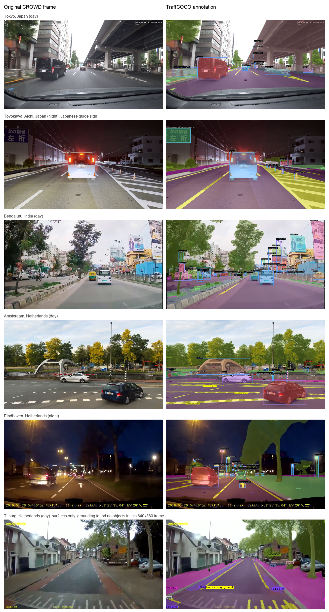
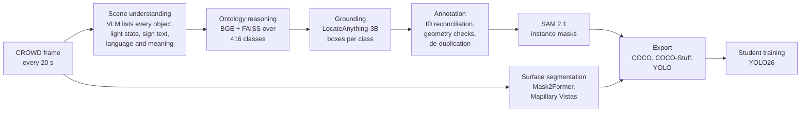

# TraffCOCO

**A worldwide, multilingual traffic-scene dataset built from dashcam video in 238 countries.**

TraffCOCO labels everything on and beside the road in frames from the
[CROWD](https://github.com/crowd-dataset/crowd) dashcam dataset:
- **Road users and vehicles:** cars, buses, auto rickshaws, cyclists, pedestrians and others.
- **The road surface and its structure:** road, sidewalk, curb, bike lane, crossings, lane markings and terrain.
- **Traffic control:** each traffic light's state, and each sign's text with its language and English meaning, in any script.

Every annotation is COCO-compatible.

CROWD has 84,038 videos from 10,735 localities in 238 countries. Sampling one frame every 20 seconds gives roughly 15 to 18 million frames.

**The plan has two parts:**
1. Label 2 to 3 million of these frames with a slow, high-quality *teacher* pipeline built from open foundation models.
2. Check that teacher against human labels, distil it into a fast *student* model, and use the student to annotate the full set.

> All figures are clickable: each one opens an interactive version (zoom, hover for labels).

[](https://htmlpreview.github.io/?https://github.com/crowd-dataset/TraffCOCO/blob/main/figures/examples.html)

*Left: original CROWD frames from Japan, India and the Netherlands, by day and at night. Right: the teacher pipeline's output.*
- **Boxes and instance masks** are the objects.
- **Tinted regions** are the road surface classes.
- **Sign labels** show the sign's meaning. The Toyokawa sign 次の信号 左折 is exported with `text`, `language: Japanese` and `meaning: next signal: turn left`.

These are raw pilot outputs, not curated results; their known errors are listed under [Current status](#current-status).

## Why TraffCOCO

Existing driving datasets do one of two things:
- they cover one or a few countries in detail (Cityscapes, KITTI, BDD100K, nuScenes);
- they cover many countries with a fixed label set and no sign text (Mapillary Vistas).

Three things are missing at scale:

1. **Geographic and cultural breadth.**
   - Road layouts, vehicles (auto rickshaws, jeepneys, kei trucks), markings and signs differ strongly between regions.
   - CROWD covers 238 countries, day and night, in naturalistic driving by many different drivers and cameras.
2. **Fine-grained traffic semantics.**
   - Downstream questions need more than "car / person / sign": what a sign says, what state a light is in, whether there is a bike lane or a sidewalk.
   - TraffCOCO uses a 416-class traffic ontology with country-specific sign classes, plus per-pixel surface classes.
3. **Text in the scene, in any language.**
   - Guide and warning signs are often written, not drawn.
   - TraffCOCO keeps the text in its original script, names the language, and gives an English meaning, so a sign keeps what it says in any language. So far this has been tested on Japanese.

## Research plan

| Phase | What | Output |
|---|---|---|
| 1. Teacher labelling | Run the pipeline below on 2–3 M frames, stratified by continent, country, day/night and vehicle type. | Objects, instance masks, surface masks, light states, sign text |
| 2. Quality assurance | Hand-label a gold set stratified the same way, measure the teacher's per-class precision and recall, calibrate its scores, and filter by agreement between models. | Measured label quality per class and per region |
| 3. Student distillation | Train detectors and segmenters (YOLO26 n to x, `training/`) on the teacher labels. Use active learning to send the student's least certain and most novel frames back for teacher or human relabelling. | Fast models that label a frame in milliseconds |
| 4. Full-scale annotation | Label the remaining ~15 M frames with the best student, with the same quality checks on a held-out sample. | TraffCOCO, ~17 M frames |
| 5. Benchmarks and release | Define tasks and baselines (below), release labels, code and models. | Dataset, leaderboard splits, baselines |

**Planned benchmark tasks:**
- **Object detection and instance segmentation** over the long-tailed ontology.
- **Surface segmentation** of road, sidewalk, curb, bike lane, crossings and markings.
- **Traffic-light state** recognition.
- **Sign reading:** OCR plus meaning, scored per script and language.
- **Cross-region generalisation:** train on some continents and test on others, to measure the geographic bias of current models.

**Leakage control:** train, validation and test splits are assigned per *video*, by hashing the video ID (80 / 10 / 10). Frames from one drive, which look nearly the same, never end up on both sides of a split.

## Pipeline

The teacher is a chain of open models, run per frame from `main.py`:



| Stage | Model | What it does |
|---|---|---|
| Frame sampling | – | Downloads CROWD videos and takes frames every `interval_seconds` (20), filtered by place, time of day, vehicle and video ID. |
| Scene understanding | Gemma 3 12B (default), Gemma 4, Qwen3-VL-8B or SmolVLM2 | Lists every traffic-relevant object with a description, light state and, for signs, the exact text in its original script, its language and English meaning. The prompt is chosen in the config. |
| Ontology reasoning | `BAAI/bge-base-en-v1.5` + FAISS | Maps each object to one of 416 ontology classes and the prompt used for grounding (`annotation_pipeline/models/ontology/traffic_ontology_v2.json`). A sign whose words the chosen class cannot represent becomes `guide_information_sign`, and the replaced class is kept for review. |
| Grounding | `nvidia/LocateAnything-3B` | Finds boxes for each class prompt. |
| Annotation | – | Links boxes to scene objects and removes slivers (under 6 px or 64 px²), implausible sizes and duplicates of the same object, keeping distant small objects such as traffic lights. Lane lines and hatched areas are taken from the surface masks instead of boxes; compact painted symbols (arrows, crossings, stop lines) stay objects. |
| Instance masks | SAM 2.1 Hiera Large | One mask per final box. |
| Surface segmentation | `facebook/mask2former-swin-large-mapillary-vistas-semantic` | Per-pixel labels for 26 road and roadside classes: road, sidewalk, curb, bike lane, crossings, lane markings, terrain, vegetation, barriers, bridges and more. |
| Road perception (optional) | YOLOPv2 | Drivable area and lane lines. |
| Export | – | COCO instances, COCO-Stuff surfaces and YOLO labels from one source of truth, split by video. |
| Student | YOLO26 | Training and inference in `training/`. |

### Output format

Per run, under `outputs/`:

```text
outputs/
├── COCO_FORMAT/
│   ├── images/{train,val,test}/
│   └── annotations/
│       ├── instances_{train,val,test,final}.json   objects + instance masks
│       └── surfaces_final.json                     road surface masks (COCO-Stuff style)
├── YOLO_FORMAT/                                     images, labels, data.yaml
├── FINAL/visualizations/<frame>_FINAL.png           combined view as in the figure
├── surface_segmentation/masks/<frame>_surface.png   uint8 label map + classes.json
├── scene_cache/{raw,parsed}/                        VLM answers per frame
├── pipeline_cache/                                  per-object scene, ontology and grounding record
└── dropped/                                         boxes removed by post-processing, for review
```

An object annotation carries the usual COCO fields plus its provenance. Signs with readable text also carry their text:

```json
{
  "category_id": 7,
  "bbox": [0, 70, 200, 114],
  "area": 22029,
  "segmentation": {"size": [720, 1280], "counts": [...]},
  "object_id": 2,
  "scene_confidence": 1.0,
  "ontology_score": 0.67,
  "sam_score": 0.98,
  "attributes": {"text": "次の信号 左折", "language": "Japanese", "meaning": "next signal: turn left"},
  "alternative_labels": ["parking_sign"]
}
```

## Current status

**Pilot stage.** The full chain runs end to end on an NVIDIA DGX Spark (GB10). On the frames in the figure, a box-by-box check by eye found 56 of 74 decidable boxes correct (76%, 16 more undecidable). Vehicles, people, streetlights and traffic lights were mostly right. Known issues that phase 2 must measure and fix:

- **Scene-model reliability.** Qwen3-VL-8B sometimes loops, repeating objects until its token limit; the parser keeps every complete object. Gemma models are the default.
- **Grounding.** LocateAnything sometimes boxes the wrong thing (a pillar as a "flexible post", tail lights as traffic lights). It returned no boxes for one low-resolution (640×360) frame. It also samples at temperature 0.7, so runs are not deterministic.
- **One description, several boxes.** A light's state, or a sign's text, is decided once per described object. When that object's query returns several boxes, the state is shared by all of them, and the sign text is attached to none (it is unknown which box says it).
- **Fine-grained confusions.** Shop signs are often labelled `billboard`, flexible posts `traffic cone`, and a rider can get an extra pedestrian or vehicle box. Some boxes span two neighbouring objects.
- **Throughput.** Measured on the DGX Spark: the VLM is the bottleneck (minutes per frame for large models), LocateAnything takes tens of seconds per frame, and SAM 2 and Mask2Former take under two seconds. Phase 1 needs batched VLM serving on HPC.

## Getting started

[](https://www.python.org/downloads/release/python-31213/)
[](https://docs.astral.sh/uv/)

Tested with **Python 3.12.13** and [`uv`](https://docs.astral.sh/uv/). A CUDA GPU is needed for the models. On aarch64 (e.g. DGX Spark) `flash-attn` and `decord` have no wheels: install with `uv sync --frozen --no-install-package flash-attn --no-install-package decord`. LocateAnything then falls back to SDPA attention.

1. Install `uv`:
   ```bash
   curl -LsSf https://astral.sh/uv/install.sh | sh
   ```
   On Windows (PowerShell): `irm https://astral.sh/uv/install.ps1 | iex`. If `uv` reports `Permission denied` under `~/.local/share/uv`, make sure you own that folder (`chown -R "$(id -un)" ~/.local/share/uv`).
2. Clone the repository and install the locked environment:
   ```bash
   git clone https://github.com/crowd-dataset/TraffCOCO
   cd TraffCOCO
   uv python install 3.12.13
   uv sync --frozen
   ```
3. Create your configuration and secrets from the defaults. Both files are required:
   ```bash
   cp default.config config
   cp default.secret secret
   ```
   `secret` holds the file-server credentials used to download CROWD videos (leave them empty for public access).
4. Run the pipeline on a few frames:
   ```bash
   uv run python main.py --images 5
   ```

### Command-line options

| Option | Meaning |
|---|---|
| `--images N` | Number of frames to process (0 = all in the input folder). |
| `--start-stage STAGE` | Resume from a stage using the cached results of the earlier ones: `scene_understanding`, `ontology_reasoning`, `grounding`, `yolopv2`, `annotation`, `semantic_verification`, `sam2`, `surface_segmentation`, `final_output`, `dataset_export`, `yolo_training`, `yolo_inference`. |
| `--no-sam-segmentation` | Skip SAM 2 instance masks. |
| `--no-yolopv2` | Skip YOLOPv2 road perception. |

### Configuration

`config` is a JSON file with the same keys as `default.config`; `main.py` stops with a list of any keys missing from it. The main groups:

- **Stages:** `run_scene_understanding`, `run_ontology_reasoning`, `run_grounding`, `run_annotation`, `run_segmentation` (SAM 2), `run_surface_segmentation`, `run_semantic_verification`, `run_yolo_training`, `run_yolo_inference`.
- **Models:** `scene_understanding_backend` (`gemma`, `gemma4`, `qwen`, `smolvlm`) with its model ID under `scene_understanding`, `scene_understanding_prompt` (a file in `annotation_pipeline/prompts/`), `ontology_reasoning.embedding`, `grounding.locate_anything_model_id`, `segmentation.sam2_model_id`, and `surface_segmentation` (`model_id`, `max_side`, and `classes`; an empty list keeps the 26 default classes).
- **Frame sampling:** `download_random_frames`, `num_images`, `interval_seconds` (20), `base_url`, `mapping` (`mapping.csv`), `local_output_root`, `delete_downloaded_videos`, and the filters `DAY_NIGHTS`, `VEHICLES`, `VIDEO_IDS` and `LOCATION_TREE` (continent → country → state → cities; use `unknown` when a country has no states):
  ```json
  "LOCATION_TREE": {
    "Asia": {"India": {"KA": ["Bengaluru"]}, "Japan": {"Tokyo": ["Tokyo"]}},
    "Europe": {"Netherlands": {"unknown": ["Eindhoven", "Tilburg", "Amsterdam"]}}
  }
  ```
  `mapping.csv` lists every CROWD locality with its videos, time of day and vehicle type; it comes from [crowd-dataset/crowd](https://github.com/crowd-dataset/crowd).
- **Limits and output:** `confidence_threshold`, `max_objects_per_image`, `locate_anything_batch_size`, `gemma_batch_size`, `save_raw_outputs`, `save_visualizations`, `save_intermediate_cache`, `benchmark`, `logger_level`.

### Repository layout

```text
main.py                         pipeline entry point (all stages)
annotation_pipeline/
  pipeline/                     scene understanding, ontology, grounding, annotation,
                                de-duplication, sign text, frame sampler
  models/                       VLM backends, ontology index, LocateAnything, SAM 2,
                                surface segmentation, YOLOPv2
  prompts/                      scene-understanding prompts
  configs/settings.py           config loading
locateanything_runtime/         LocateAnything batch runtime
training/                       YOLO26 student training, validation and inference
tools/make_readme_examples.py   builds figures/examples.{png,html} from a run
mapping.csv                     CROWD localities and videos
```

The README figure is rebuilt from a finished run with
`uv run --with plotly python tools/make_readme_examples.py --frames random_frames --outputs outputs`.

## License

MIT, see [LICENSE](LICENSE).
